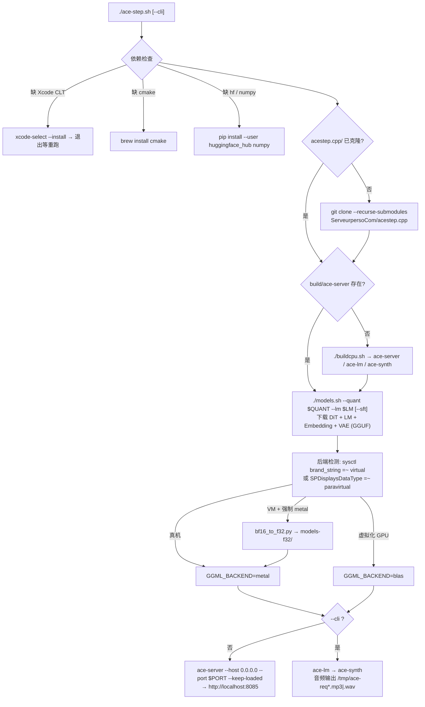
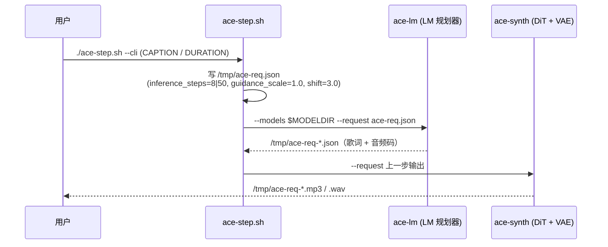

<div align="center">

> [English](./README_en.md) | **简体中文**


# ace-step-mac — 在 Mac 上一键跑 ACE-Step 1.5

**一条 bash 命令：装依赖 → 编译 C++ 推理 → 下 GGUF 模型 → 打开浏览器生成音乐。**


</div>

---

## 它解决什么问题

想在 Mac 本地生成音乐，官方 [ACE-Step 1.5](https://github.com/ace-step/ACE-Step-1.5) 是完整 Python 栈，依赖重、上手门槛高。本仓库把它压缩成**一个 bash 脚本**：底层换成社区 C++ 移植 [acestep.cpp](https://github.com/ServeurpersoCom/acestep.cpp)（GGUF/GGML，Metal GPU + Accelerate BLAS），比 Python 版更轻更快；脚本替你处理依赖、克隆、编译、模型下载，以及一件最容易踩坑的事——**虚拟化 GPU 上没有 bf16 指令，Metal 会直接崩**，这里自动检测并切到 CPU。

> 开箱即用：不设任何环境变量也能跑；要调参时 7 个环境变量全部有默认值。

---

## ✨ 功能

- **真·一键**：自动装 Xcode CLT / cmake / `hf` CLI / numpy → `git clone --recurse-submodules` acestep.cpp → `./buildcpu.sh` 编译 → `./models.sh` 下载模型 → 启动 WebUI，已装好的步骤自动跳过。
- **双模式**：默认起 `ace-server` WebUI（`http://localhost:8085`）；`--cli` 不开服务器直接生成一首歌到 `/tmp`。
- **后端自动选择**：`sysctl` + `system_profiler` 检测虚拟化 GPU——真机走 Metal，Mac 虚拟机（Devin/UTM/Parallels 的 Apple Paravirtual GPU）自动切 Accelerate BLAS。
- **BF16 兜底**：VM 上强制 Metal 时，`tools/bf16_to_f32.py` 把 GGUF 里的 BF16 张量无损位扩展成 F32，写入 `models-f32/`。
- **全参数可调**：LM 大小（0.6B/1.7B/4B）、DiT 变体（turbo/sft）、量化（Q4_K_M~BF16）、后端、端口、时长、曲风描述，全部走环境变量。

---

## 🚀 快速开始

### 方式一：面向 AI Agent（一键提示词，推荐）

````markdown
请在 macOS (Apple Silicon) 上帮我部署本地音乐生成项目 ace-step-mac：
1. git clone https://github.com/RayMorTwinkle/ace-step-mac.git && cd ace-step-mac
2. 运行 ./ace-step.sh。它会自动：安装 Xcode Command Line Tools / cmake / hf CLI / numpy，
   克隆并编译 acestep.cpp，然后用 HuggingFace 的 hf CLI 下载数 GB 的 GGUF 模型（首次较慢）。
3. 若脚本提示安装 Xcode CLT，在系统弹窗点 Install 后重跑脚本。
4. 完成后打开 http://localhost:8085 使用 WebUI；如需命令行单次生成，改用 ./ace-step.sh --cli。
环境要求：Apple Silicon Mac、Homebrew、可用网络。无需我提供任何密钥。
````

### 方式二：面向人类用户

```bash
git clone https://github.com/RayMorTwinkle/ace-step-mac.git
cd ace-step-mac
./ace-step.sh            # 装依赖 → 编译 → 下模型 → 开 WebUI
```

打开 http://localhost:8085 ，写描述 → 生成 → 播放/下载。命令行直出一首歌（不开服务器）：

```bash
./ace-step.sh --cli
```

> **环境要求**：macOS（Apple Silicon）、Homebrew、网络。首次运行需下载数 GB 模型；脚本自动检测虚拟化 GPU 并选择 Metal/BLAS，无需手动干预。

---

## 🖥️ 使用

### 可调参数（环境变量，全部有默认值）

| 变量 | 可选值 | 默认 | 说明 |
|---|---|---|---|
| `LM` | `0.6B` / `1.7B` / `4B` | `0.6B` | LM 规划器（写歌词+结构），越大质量越好越慢 |
| `DIT` | `turbo` / `sft` | `turbo` | DiT 扩散模型：turbo=8 步（快）/ sft=50 步（质量略高） |
| `QUANT` | `Q4_K_M`/`Q5_K_M`/`Q6_K`/`Q8_0`/`BF16` | `Q8_0` | 量化级别；CPU 上 Q8_0 反而比 Q4_K_M 快 |
| `BACKEND` | `auto`/`metal`/`blas`/`cpu` | `auto` | 自动检测：真机→Metal，虚拟机→BLAS |
| `PORT` | 任意端口 | `8085` | WebUI 端口 |
| `DURATION` | 秒数 | `60` | `--cli` 模式生成时长 |
| `CAPTION` | 文本 | 内置英文 EDM 描述 | `--cli` 曲风描述，英文效果更好 |

```bash
LM=1.7B DIT=sft ./ace-step.sh        # 更大 LM + 高质量 DiT
QUANT=Q4_K_M ./ace-step.sh           # 最小模型文件
DURATION=120 CAPTION="sad lo-fi piano ballad" ./ace-step.sh --cli
BACKEND=blas ./ace-step.sh           # 强制 CPU/Accelerate
```

**注意 turbo/sft 和 0.6B/4B 是两个不同维度**：前者是 DiT 变体（生成步数），后者是 LM 大小（规划质量）。推荐组合：turbo + 0.6B（速度优先）/ turbo + 1.7B（平衡）。

### 实测速度（M4 Pro 虚拟机 16GB，CPU/Accelerate）

| 阶段 | 时间 |
|---|---|
| LM 0.6B（歌词+音频码，30s 歌） | ~3s（90–155 tok/s） |
| DiT turbo 8 步（88s 音频） | ~23s |
| VAE 解码（88s 音频） | ~45s |
| **整首 88s 歌端到端** | **~80s ≈ 实时** |

真机 Metal GPU 上 DiT 比这台 VM 快约 3 倍（上游 CI：88s 音频 DiT 仅 7.1s）。

---

## 🏗️ 架构

### 脚本流水线



### CLI 生成时序



---

## 📂 目录结构

```text
ace-step-mac/
├── ace-step.sh            # 一键脚本：依赖 → 克隆 → 编译 → 模型 → 后端 → 运行
├── tools/
│   └── bf16_to_f32.py     # GGUF BF16→F32 张量无损转换器（无 bf16 GPU 用）
├── acestep.cpp/           # 首次运行时自动 clone（.gitignore）
│   ├── models/            # hf CLI 下载的 GGUF 权重
│   ├── models-f32/        # VM + 强制 Metal 时生成的 F32 副本（.gitignore）
│   └── build/             # ace-server / ace-lm / ace-synth
└── assets/logo.svg
```

---

## 🔧 技术细节

- **虚拟化检测**：`sysctl -n machdep.cpu.brand_string | grep -qi virtual` 或 `system_profiler SPDisplaysDataType | grep -qi paravirtual` 命中任一即 `IS_VM=1`；`BACKEND=auto` 时 VM→`blas`，真机→`metal`，结果写入 `GGML_BACKEND` 环境变量。
- **BF16→F32 触发条件**：仅当「VM 且 `BACKEND` 被强制为 `metal`」才转换；`auto` 路径下 VM 走 BLAS，不挑张量类型，不转。
- **模型文件命名**：`acestep-5Hz-lm-${LM}-${QUANT}.gguf`（LM）、`acestep-v15-${DIT}-${QUANT}.gguf`（DiT），另有 Embedding + VAE 由 `models.sh` 一并下载；`DIT=sft` 时追加 `--sft` 参数。
- **CLI 请求体**：`/tmp/ace-req.json`，字段 `lm_model` / `synth_model` / `caption` / `vocal_language:"en"` / `duration` / `inference_steps`（turbo=8，sft=50）/ `guidance_scale:1.0` / `shift:3.0`；`ace-lm` 产出的中间 JSON 再喂给 `ace-synth`。
- **ace-server 参数**：`--models $MODELDIR --adapters ./adapters --host 0.0.0.0 --port $PORT --keep-loaded`。
- **bf16_to_f32.py**：纯标准库 + numpy 的 GGUF 重写器。解析 GGUFv3 头（magic `GGUF`、KV、tensor info），GGUF 类型码 `F32=0`、`BF16=30`；BF16 张量按 `uint16 << 16` 无损位扩展为 F32，量化张量原样拷贝（长度由下一个张量 offset 推断）；对齐读 `general.alignment` KV（默认 32）；`--check` 只探测文件是否含 BF16 张量。
- **`hf` CLI 兜底**：脚本把 `$HOME/Library/Python/3.9/bin`、`$HOME/Library/Python/3.*/bin` 加进 PATH，兼容 pip `--user` 安装的 `hf`。
- **内存参考**：Q8_0 全家桶（0.6B LM + turbo + VAE）约 4GB 权重，16GB 够用；4B LM + XL DiT 需要 20GB+。

---

## ❓ 常见问题

**Q：虚拟机里 Metal 为什么不能直接用？**
A：Apple Paravirtual GPU 没有 simdgroup 矩阵单元和 bf16 支持——GGUF 里的 BF16 张量会让 Metal scheduler 直接 abort；即使转成 F32，Paravirtual 上的 Metal 也比 CPU 慢。脚本检测后自动用 Accelerate BLAS，这是这台机器上的最快路径。

**Q：已经装过依赖/下过模型，重跑会重来吗？**
A：不会。`acestep.cpp/`、`build/ace-server`、已下载的模型文件存在即跳过；`models-f32/` 里已转换的文件也跳过。

**Q：生成的歌去哪了？**
A：`--cli` 模式输出在 `/tmp/ace-req*.mp3|.wav`；WebUI 模式在浏览器里播放/下载。

**Q：要完整功能（LoRA 训练、cover、repaint）怎么办？**
A：用官方 Python 栈：上游 [ACE-Step-1.5](https://github.com/ace-step/ACE-Step-1.5) 的 `uv run acestep`（MLX/MPS）；想嵌进自己代码可用 [mlx-community/ACE-Step1.5-MLX](https://huggingface.co/mlx-community/ACE-Step1.5-MLX) + `mlx-audio`。

---

## ⚠️ 注意事项

- 首次运行会下载数 GB 模型（HuggingFace），需要稳定网络。
- 脚本要求 Xcode Command Line Tools 弹窗需手动点 Install，之后重跑脚本。
- `CAPTION` 用英文描述效果更好（脚本默认即是英文 EDM 描述）。
- 面向 Apple Silicon 编写并验证；Intel Mac 未经测试。
- `acestep.cpp/`、`models-f32/`、`*.mp3`、`*.wav` 已在 `.gitignore` 中。

---

## 📄 License

本仓库脚本与工具未单独声明 License。上游 [acestep.cpp](https://github.com/ServeurpersoCom/acestep.cpp) 与 [ACE-Step](https://github.com/ace-step/ACE-Step-1.5) 及其模型权重遵循各自仓库的 License，下载使用前请自行确认。

---

## 🙏 致谢

- [ace-step/ACE-Step-1.5](https://github.com/ace-step/ACE-Step-1.5) — 上游模型与论文，本仓库仅是它的 Mac 一键启动器。
- [ServeurpersoCom/acestep.cpp](https://github.com/ServeurpersoCom/acestep.cpp) — ACE-Step 1.5 的 GGUF/GGML C++ 移植（Metal + Accelerate BLAS），本脚本围绕它构建。
- HuggingFace — 模型权重托管与 `hf` 下载 CLI。

<div align="center">
<sub>ace-step-mac · 一条命令，让 Mac 给你写歌。</sub>
</div>
