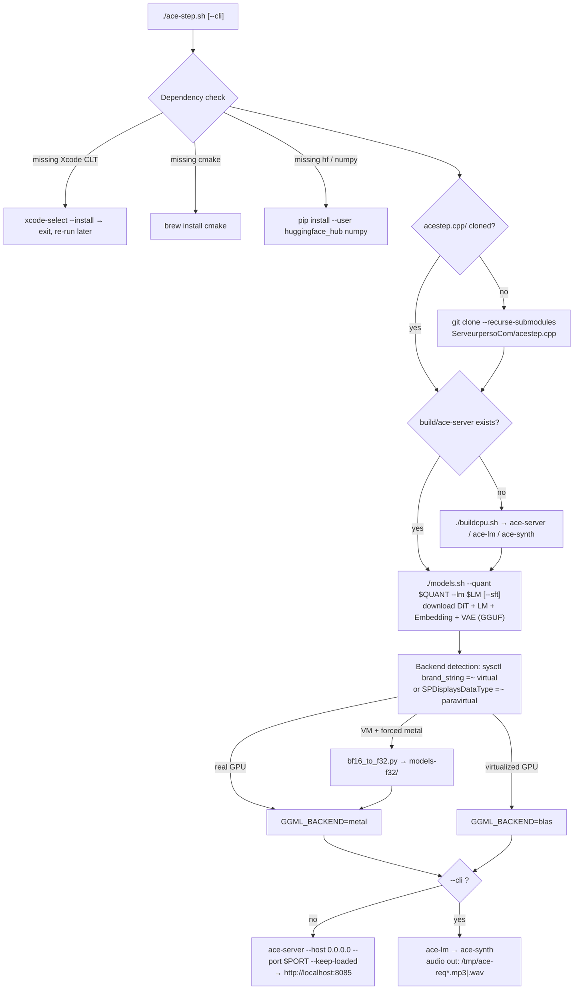
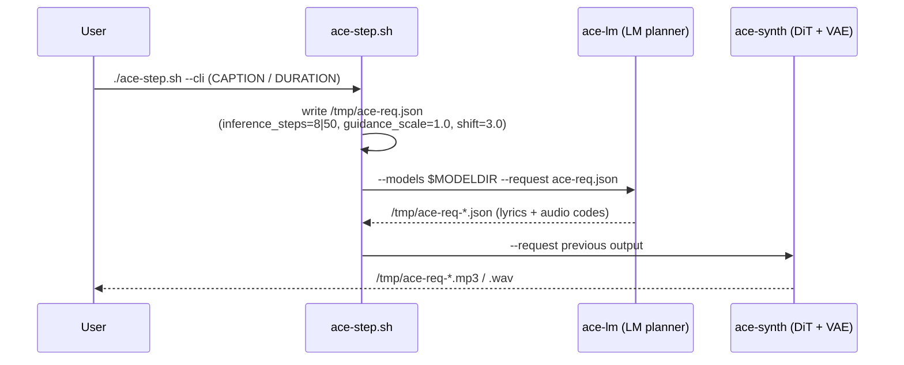

<div align="center">

> **English** | [简体中文](./README.md)


# ace-step-mac — One-click ACE-Step 1.5 on Mac

**A single bash command: install deps → build the C++ engine → download GGUF models → generate music in your browser.**


</div>

---

## Why it exists

Generating music locally on a Mac with the official [ACE-Step 1.5](https://github.com/ace-step/ACE-Step-1.5) means pulling in a full Python stack — heavy dependencies, non-trivial setup. This repo compresses the whole thing into **one bash script** built on the community C++ port [acestep.cpp](https://github.com/ServeurpersoCom/acestep.cpp) (GGUF/GGML, Metal GPU + Accelerate BLAS), which is lighter and faster than the Python version. The script handles dependencies, cloning, building and model downloads — plus the one trap everyone hits: **virtualized GPUs lack bf16 support, so Metal crashes outright**. It detects that automatically and falls back to CPU.

> Zero-config by default: every tunable is an environment variable with a sensible default.

---

## ✨ Features

- **Truly one click**: auto-installs Xcode CLT / cmake / `hf` CLI / numpy → `git clone --recurse-submodules` acestep.cpp → `./buildcpu.sh` build → `./models.sh` model download → WebUI launch. Already-done steps are skipped.
- **Two modes**: `ace-server` WebUI at `http://localhost:8085` by default, or `--cli` to generate one song to `/tmp` with no server.
- **Automatic backend selection**: detects virtualized GPUs via `sysctl` + `system_profiler` — real hardware gets Metal; Mac VMs (Apple Paravirtual GPU in Devin/UTM/Parallels) get Accelerate BLAS.
- **BF16 fallback**: when Metal is forced on a VM, `tools/bf16_to_f32.py` losslessly bit-expands BF16 tensors to F32 into `models-f32/`.
- **Fully tunable**: LM size (0.6B/1.7B/4B), DiT variant (turbo/sft), quantization (Q4_K_M~BF16), backend, port, duration and caption — all via env vars.

---

## 🚀 Quick Start

### Option 1: prompt for an AI agent (recommended)

````markdown
Deploy the local music-generation project ace-step-mac on macOS (Apple Silicon):
1. git clone https://github.com/RayMorTwinkle/ace-step-mac.git && cd ace-step-mac
2. Run ./ace-step.sh. It will automatically: install Xcode Command Line Tools / cmake / the hf CLI / numpy,
   clone and build acestep.cpp, then download several GB of GGUF models via HuggingFace's hf CLI (first run is slow).
3. If the script asks to install Xcode CLT, click Install in the system dialog and re-run the script.
4. Open http://localhost:8085 for the WebUI; for one-shot CLI generation use ./ace-step.sh --cli instead.
Requirements: Apple Silicon Mac, Homebrew, network access. No API keys needed.
````

### Option 2: manual

```bash
git clone https://github.com/RayMorTwinkle/ace-step-mac.git
cd ace-step-mac
./ace-step.sh            # deps → build → models → WebUI
```

Open http://localhost:8085, write a description → generate → play/download. One-shot CLI generation (no server):

```bash
./ace-step.sh --cli
```

> **Requirements**: macOS (Apple Silicon), Homebrew, network access. The first run downloads several GB of models; virtualized-GPU detection and Metal/BLAS selection are automatic.

---

## 🖥️ Usage

### Tunables (env vars, all with defaults)

| Variable | Values | Default | Description |
|---|---|---|---|
| `LM` | `0.6B` / `1.7B` / `4B` | `0.6B` | LM planner (lyrics + structure); larger = better, slower |
| `DIT` | `turbo` / `sft` | `turbo` | DiT diffusion model: turbo = 8 steps (fast) / sft = 50 steps (slightly better) |
| `QUANT` | `Q4_K_M`/`Q5_K_M`/`Q6_K`/`Q8_0`/`BF16` | `Q8_0` | Quantization; on CPU, Q8_0 is actually faster than Q4_K_M |
| `BACKEND` | `auto`/`metal`/`blas`/`cpu` | `auto` | Auto-detect: real GPU → Metal, VM → BLAS |
| `PORT` | any port | `8085` | WebUI port |
| `DURATION` | seconds | `60` | Song length in `--cli` mode |
| `CAPTION` | text | built-in English EDM caption | `--cli` style description; English works best |

```bash
LM=1.7B DIT=sft ./ace-step.sh        # bigger LM + high-quality DiT
QUANT=Q4_K_M ./ace-step.sh           # smallest model files
DURATION=120 CAPTION="sad lo-fi piano ballad" ./ace-step.sh --cli
BACKEND=blas ./ace-step.sh           # force CPU/Accelerate
```

**Note that turbo/sft and 0.6B/4B are two independent axes**: the former is the DiT variant (step count), the latter the LM size (planning quality). Recommended combos: turbo + 0.6B (speed) / turbo + 1.7B (balanced).

### Measured speed (M4 Pro VM, 16GB, CPU/Accelerate)

| Stage | Time |
|---|---|
| LM 0.6B (lyrics + audio codes, 30s song) | ~3s (90–155 tok/s) |
| DiT turbo, 8 steps (88s audio) | ~23s |
| VAE decode (88s audio) | ~45s |
| **Full 88s song, end to end** | **~80s ≈ real-time** |

On real Metal GPU hardware, DiT is about 3× faster than on this VM (upstream CI: 7.1s of DiT for 88s audio).

---

## 🏗️ Architecture

### Script pipeline



### CLI generation sequence



---

## 📂 Project layout

```text
ace-step-mac/
├── ace-step.sh            # one-click script: deps → clone → build → models → backend → run
├── tools/
│   └── bf16_to_f32.py     # lossless GGUF BF16→F32 tensor converter (for GPUs without bf16)
├── acestep.cpp/           # auto-cloned on first run (.gitignore)
│   ├── models/            # GGUF weights downloaded via hf CLI
│   ├── models-f32/        # F32 copies generated when Metal is forced on a VM (.gitignore)
│   └── build/             # ace-server / ace-lm / ace-synth
└── assets/logo.svg
```

---

## 🔧 Technical notes

- **Virtualization detection**: `sysctl -n machdep.cpu.brand_string | grep -qi virtual` or `system_profiler SPDisplaysDataType | grep -qi paravirtual` — either hit sets `IS_VM=1`. With `BACKEND=auto`, a VM resolves to `blas` and real hardware to `metal`; the result is exported as `GGML_BACKEND`.
- **BF16→F32 trigger**: conversion only happens when the machine is a VM *and* `BACKEND` was forced to `metal`. On the `auto` path a VM uses BLAS, which doesn't care about tensor types, so nothing is converted.
- **Model file naming**: `acestep-5Hz-lm-${LM}-${QUANT}.gguf` (LM) and `acestep-v15-${DIT}-${QUANT}.gguf` (DiT); Embedding + VAE are also fetched by `models.sh`, which gets a `--sft` flag when `DIT=sft`.
- **CLI request body**: `/tmp/ace-req.json` with fields `lm_model` / `synth_model` / `caption` / `vocal_language:"en"` / `duration` / `inference_steps` (turbo=8, sft=50) / `guidance_scale:1.0` / `shift:3.0`. `ace-lm` emits an intermediate JSON that is then fed to `ace-synth`.
- **ace-server flags**: `--models $MODELDIR --adapters ./adapters --host 0.0.0.0 --port $PORT --keep-loaded`.
- **bf16_to_f32.py**: a GGUF rewriter using only stdlib + numpy. Parses the GGUFv3 header (magic `GGUF`, KV pairs, tensor infos); GGUF type codes `F32=0`, `BF16=30`. BF16 tensors are losslessly expanded via `uint16 << 16` reinterpretation into F32; quantized tensors are copied verbatim (their length is inferred from the next tensor's offset). Alignment comes from the `general.alignment` KV (default 32). `--check` only probes whether a file contains BF16 tensors.
- **`hf` CLI fallback**: the script prepends `$HOME/Library/Python/3.9/bin` and `$HOME/Library/Python/3.*/bin` to PATH so a pip `--user`–installed `hf` is found.
- **Memory reference**: the Q8_0 full set (0.6B LM + turbo + VAE) is ~4GB of weights — 16GB is enough; 4B LM + XL DiT needs 20GB+.

---

## ❓ FAQ

**Q: Why can't a VM just use Metal?**
A: The Apple Paravirtual GPU has no simdgroup matrix units and no bf16 support — BF16 tensors in the GGUF make the Metal scheduler abort, and even after F32 conversion Metal on Paravirtual is slower than CPU. The script detects this and uses Accelerate BLAS, which is the fastest path on such a machine.

**Q: Will re-running repeat the downloads/build?**
A: No. `acestep.cpp/`, `build/ace-server`, downloaded model files and already-converted files in `models-f32/` are all skipped when present.

**Q: Where do generated songs go?**
A: `--cli` mode writes `/tmp/ace-req*.mp3|.wav`; the WebUI lets you play/download in the browser.

**Q: What if I want the full feature set (LoRA training, cover, repaint)?**
A: Use the official Python stack: upstream [ACE-Step-1.5](https://github.com/ace-step/ACE-Step-1.5) via `uv run acestep` (MLX/MPS); to embed it in your own code, try [mlx-community/ACE-Step1.5-MLX](https://huggingface.co/mlx-community/ACE-Step1.5-MLX) + `mlx-audio`.

---

## ⚠️ Notes

- The first run downloads several GB of models from HuggingFace — a stable connection is required.
- The Xcode Command Line Tools prompt requires a manual click on Install; re-run the script afterwards.
- English `CAPTION`s produce better results (the built-in default is an English EDM caption).
- Written for and verified on Apple Silicon; Intel Macs are untested.
- `acestep.cpp/`, `models-f32/`, `*.mp3` and `*.wav` are in `.gitignore`.

---

## 📄 License

The script and tools in this repo carry no explicit license. The upstream [acestep.cpp](https://github.com/ServeurpersoCom/acestep.cpp) and [ACE-Step](https://github.com/ace-step/ACE-Step-1.5) projects — and their model weights — are governed by their own licenses; please review them before downloading and using the models.

---

## 🙏 Credits

- [ace-step/ACE-Step-1.5](https://github.com/ace-step/ACE-Step-1.5) — the upstream model and research; this repo is only a Mac launcher for it.
- [ServeurpersoCom/acestep.cpp](https://github.com/ServeurpersoCom/acestep.cpp) — the GGUF/GGML C++ port of ACE-Step 1.5 (Metal + Accelerate BLAS) this script is built around.
- HuggingFace — model weight hosting and the `hf` download CLI.

<div align="center">
<sub>ace-step-mac · One command, and your Mac writes you a song.</sub>
</div>
